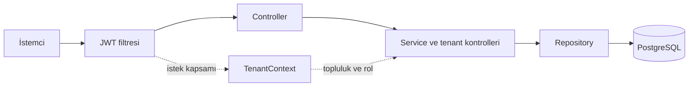

# Community Management API

**Toplulukların üyelerini, ekiplerini ve çalışmalarını tek bir API üzerinden yönetin.**

Topluluk bünyesinde ekip olarak geliştirilen bu proje; komite organizasyonu, proje takibi, görev paylaşımı ve etkinlik katılımı gibi süreçleri bir araya getirir. Birden fazla topluluğun aynı uygulama ve veritabanı üzerinde çalışabilmesi için topluluk bazlı erişim kontrolleri kullanır.

Bu depo Java ve Spring Boot ile geliştirilmiş backend uygulamasını içerir. Frontend bu depoda yer almaz.

## Neler sunuyor?

| Alan | Özellikler |
| --- | --- |
| Topluluklar | Topluluk oluşturma, güncelleme, aktiflik durumu ve yönetici özeti |
| Üyeler | Kayıt ve giriş, profil, yetenekler, sosyal bağlantılar ve hesap durumu |
| Komiteler | Komite oluşturma, güncelleme ve üye listeleme |
| Projeler ve görevler | Proje panosu, görev üstlenme, devretme, tamamlama ve durum takibi |
| Etkinlikler ve toplantılar | Planlama, QR verisiyle katılım doğrulama ve katılımcı listeleri |
| İstatistikler | Aktivite geçmişi, görev puanları, aylık geçmiş ve liderlik tablosu |
| Kimlik doğrulama | JWT access token, refresh token ve rol kontrolleri |

## Teknolojiler

- **Java 21 · Spring Boot 4.0.3**
- **Spring Security · JJWT** — kimlik doğrulama ve yetkilendirme
- **Spring Data JPA · PostgreSQL 16** — veri erişimi ve kalıcı depolama
- **MapStruct · Lombok** — nesne dönüşümleri ve yardımcı kod üretimi
- **Springdoc OpenAPI** — Swagger UI üzerinden API dokümantasyonu
- **JUnit · Mockito · H2** — birim ve entegrasyon testleri
- **Docker Compose · Apache HTTP Server** — konteynerler ve ters proxy
- **Actuator · Micrometer / Prometheus** — sağlık kontrolü ve metrikler

Flyway migration dosyaları da depoda bulunur; mevcut Docker Compose yapılandırması bunları çalıştırmaz.

## Mimari



Veriler ortak veritabanında tutulur. Toplulukla ilişkili kayıtlar `community_id` üzerinden ayrılır; servislerdeki erişim kontrolleri ve topluluk filtreli repository sorguları bu kapsamı uygular. Her topluluk için ayrı veritabanı açılmaz.

- `TenantContext`, kullanıcının kimliğini, topluluğunu ve rollerini istek boyunca taşır; filtre sonunda temizlenir.
- `TenantResolver`, mevcut kullanıcının topluluk kapsamını çözer.
- `TenantAccessValidator`, erişilen kaynağın topluluk kapsamını doğrular. `SUPER_ADMIN` bu kapsam kontrolünden muaftır.

Sistem rolleri `SUPER_ADMIN`, `COMMUNITY_ADMIN` ve `USER`; topluluk rolleri ise `BASKAN`, `BASKAN_YARDIMCISI`, `KOMITE_LIDERI`, `KOMITE_YARDIMCISI` ve `UYE` olarak tanımlıdır. İşlem yetkileri ilgili servislerde kontrol edilir.

## Docker ile yerel kurulum

Docker Engine / Docker Desktop ve Docker Compose gereklidir. Aşağıdaki komutları proje kökünde çalıştırın.

### 1. Ortam dosyasını hazırlayın

Proje kökünde `.env` oluşturun ve aşağıdaki alanları doldurun:

```dotenv
POSTGRES_DB=community_db
POSTGRES_USER=community_user
POSTGRES_PASSWORD=replace-with-your-local-password
DB_PORT=5432
DB_SCHEMA=public
SPRING_PROFILES_ACTIVE=prod
SERVER_PORT=8000
APACHE_HTTP_PORT=80
JWT_SECRET=replace-with-a-base64-encoded-random-key
CORS_ALLOWED_ORIGINS=http://localhost:5173,http://127.0.0.1:5173
```

`JWT_SECRET`, en az 32 rastgele baytın Base64 karşılığı olmalıdır. Örneğin `openssl rand -base64 32` ile üretebilirsiniz. Örnek parola ve anahtar alanlarını kendi değerlerinizle değiştirin. `.env` dosyası Git tarafından yok sayılır.

Bu yerel kurulumda PostgreSQL'in mevcut `public` şeması kullanılır. Varsayılan `hsd` şemasını kullanmak isterseniz, Flyway kapalı olduğu için şemayı önce kendiniz oluşturun.

### 2. Servisleri başlatın

```bash
docker compose up --build -d
docker compose ps
docker compose logs -f api
```

Compose; PostgreSQL, API ve Apache servislerini başlatır. Veritabanı `postgres_data` volume'ünde saklanır.

| Servis | Adres |
| --- | --- |
| Swagger UI | http://localhost:8000/swagger-ui/index.html |
| OpenAPI tanımı | http://localhost:8000/v3/api-docs |
| Sağlık kontrolü | http://localhost:8000/actuator/health |
| Apache üzerinden API | http://localhost/api/v1/community |

Servisleri durdurmak için `docker compose down` kullanın.

> Mevcut Compose dosyası `prod` profilini seçse de `ddl-auto=update` ve `FLYWAY_ENABLED=false` değerlerini zorunlu olarak ayarlar. Bu kurulum yerel geliştirme içindir; üretim ortamına yönelik tamamlanmış bir migration veya HTTPS kurulumu değildir.

### 3. İlk verileri hazırlayın

Boş veritabanında otomatik topluluk veya yönetici hesabı oluşturulmaz. Kayıt işlemi mevcut bir `community_id` ister; API üzerinden topluluk oluşturmak ise `SUPER_ADMIN` yetkisi gerektirir. İlk topluluk ve yönetici hesabı için veritabanı üzerinden başlangıç verisi hazırlanmalıdır; kullanıcı parolası BCrypt ile hashlenmelidir.

Kökteki `seed.sql` eski `community` tablosuna yöneliktir ve mevcut `communities` modeliyle uyuşmaz; doğrudan çalıştırılmamalıdır.

## API'yi kullanma

Swagger UI, istek ve yanıt modellerini incelemek için başlangıç noktasıdır. Kayıt veya giriş yanıtındaki access token ile korumalı isteklere şu başlığı ekleyin:

```http
Authorization: Bearer <access_token>
```

| Modül | Temel yol |
| --- | --- |
| Kimlik doğrulama | `/api/v1/auth` |
| Topluluklar | `/api/v1/community` |
| Kullanıcılar | `/api/v1/users` |
| Komiteler | `/api/v1/committees` |
| Projeler | `/api/v1/projects` |
| Proje görevleri | `/api/v1/project-task` |
| Etkinlikler | `/api/v1/events` |
| Toplantılar | `/api/v1/meetings` |
| Ortak QR katılımı | `/api/v1/qr/attendances` |
| İstatistikler | `/api/v1/stats` |

Örnek uçlar: `POST /api/v1/auth/login`, `GET /api/v1/users/me`, `GET /api/v1/projects/{id}/board` ve `GET /api/v1/stats/leader-board`.

## Geliştirme ve testler

Yerel Java geliştirmesi için JDK 21 gereklidir. Backend dizininde Maven Wrapper ile testleri çalıştırabilirsiniz:

```powershell
cd backend
.\mvnw.cmd test
```

Linux / macOS karşılığı: `./mvnw test`. Wrapper'ın ilk çalıştırılması Maven ve bağımlılıkları indirmek için internet bağlantısı gerektirebilir.

Testler H2 üzerinde uygulama bağlamını, proje servis işlemlerini, topluluklar arası erişim senaryolarını, rol kontrollerini ve migration dosyasındaki belirli kuralları kapsar. Test profilinde Flyway kapalıdır; bu testler PostgreSQL migration sürecinin uçtan uca doğrulandığı anlamına gelmez.

IDE veya Maven ile API'yi çalıştırma ayrıntıları için [backend geliştirme notlarına](backend/README.md) bakabilirsiniz.

## Dizin yapısı

```text
backend/
  src/main/java/com/devkit/hsd/
    common/tenant/   # Topluluk kapsamı ve erişim kontrolleri
    config/          # Güvenlik, CORS ve OpenAPI
    controller/      # REST uçları
    dto/             # İstek ve yanıt modelleri
    entity/          # JPA varlıkları
    mapper/          # MapStruct dönüşümleri
    repository/      # Veri erişimi
    service/         # İş kuralları
    exception/       # Hata yönetimi
  src/main/resources/ # Uygulama ayarları ve migration dosyaları
  src/test/           # Birim ve entegrasyon testleri
apache/               # HTTP ters proxy yapılandırması
docker-compose.yml    # Yerel servis kurulumu
```

## Geliştirme notları

- Migration zinciri boş veritabanı kurulumu için tamamlanmış değildir: `V1` yalnızca şema oluşturur, `V2` mevcut tabloları değiştirir.
- Kullanıcı adı kontrolü kayıt servisinde topluluk bazlıdır; ancak entity'de kullanıcı adı global olarak benzersizdir ve giriş kullanıcı adıyla yapılır. Aynı kullanıcı adının farklı topluluklarda kullanılması mevcut sürümde desteklenmiş kabul edilmemelidir.
- Yerel ayarlardaki örnek parolalar ve JWT anahtarları gerçek ortamda kullanılmamalıdır. Paylaşım öncesinde yerel ayarlar ve yedek yapılandırma dosyaları kontrol edilmelidir.

## Projenin kökeni

Bu çalışma topluluk içinde ekip olarak geliştirilmiştir. Bu depodaki paylaşım, ortak geliştirilen projenin kişisel GitHub hesabındaki kopyasıdır.
